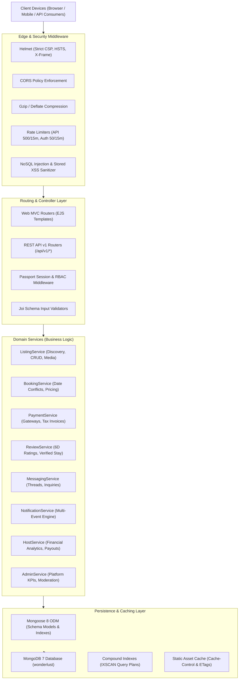
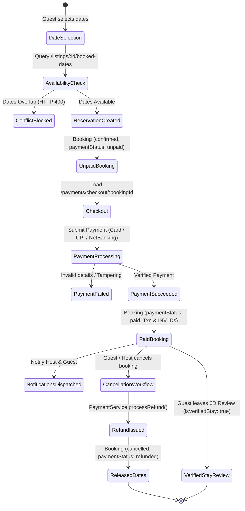

# Wander-Lust — Enterprise Vacation Rental Marketplace

[](https://nodejs.org/)
[](https://expressjs.com/)
[](https://www.mongodb.com/)
[](https://www.docker.com/)
[](https://pm2.keymetrics.io/)
[-brightgreen.svg?style=flat-square)](https://github.com/)
[](https://helmetjs.github.io/)
[](https://opensource.org/licenses/ISC)

> **Wander-Lust** is a commercial, production-ready full-stack vacation rental marketplace built with **Node.js, Express, MongoDB, and modern EJS**. Engineered with high-throughput layered service architecture, multi-role RBAC governance, real-time messaging, payment gateway processing with GST-compliant tax invoicing, asynchronous event notifications, 6-dimensional reputation analytics, and containerized Docker deployment.

---

## Table of Contents

1. [Architectural Overview & System Design](#-architectural-overview--system-design)
2. [Commercial Feature Matrix](#-commercial-feature-matrix)
3. [Technology Stack](#-technology-stack)
4. [REST API v1 Specification](#-rest-api-v1-specification)
5. [Getting Started & Local Setup](#-getting-started--local-setup)
6. [Environment Configuration](#-environment-configuration)
7. [Database Seeding & Preserved State](#-database-seeding--preserved-state)
8. [Production Containerization (Docker)](#-production-containerization-docker)
9. [Process Management (PM2 Cluster)](#-process-management-pm2-cluster)
10. [Automated Testing & Quality Assurance](#-automated-testing--quality-assurance)
11. [Operational Runbook & Security Posture](#-operational-runbook--security-posture)
12. [License & Acknowledgments](#-license--acknowledgments)

---

## Architectural Overview & System Design

Wander-Lust follows a strict **Layered Service-Oriented Architecture (SoA)** decoupling HTTP transport, validation, business domain logic, data persistence, and security middleware:



### Marketplace Booking & Payment State Lifecycle



---

## Commercial Feature Matrix

| Domain Module | Key Features & Enterprise Capabilities |
| :--- | :--- |
| **Search & Discovery** | Full-text title/description search, regex match, 12 categories, 10 property types, price filtering, guest capacity filters, sorting (price asc/desc, newest, rating, views), debounced autocomplete suggestions (`/api/v1/listings/suggestions`), pagination with query parameter persistence. |
| **Media Pipeline** | Multi-image gallery with primary image flags, universal multipart/form-data upload pipeline (`handleListingUpload`), local disk storage with automated filename hashing and Cloudinary integration fallback, interactive Leaflet/OpenStreetMap geospatial coordinate rendering. |
| **UX & Design System** | High-contrast commercial design tokens, frosted glass blur navigation bar, mobile bottom drawer navigation, responsive sticky booking card, hover elevation animations, client-side wishlist management with modal views, dismissible flash toast alerts. |
| **Booking & Reservation** | Real-time calendar availability engine, date overlap collision prevention, transparent itemized pricing (nights $\times$ base price + ₹500 cleaning fee + 18% GST), guest trips dashboard, host reservations dashboard, self-booking prevention guard. |
| **Payment Gateway** | Multi-channel payment order processing (Credit/Debit Card, UPI, NetBanking), idempotency protection, tamper guards against price manipulation, automated transaction reference generation (`txn_`, `order_`, `INV-`), SAC code 996311 GST digital tax receipts with CGST/SGST itemization. |
| **Host Management** | User profile customization with avatar upload, Host Financial Analytics Dashboard (gross revenue, net earnings after 10% platform fee, booking counts, occupancy rates, monthly breakdown charts), Superhost elevation badge system. |
| **Reputation & Reviews** | 6-dimensional rating engine (`cleanliness`, `accuracy`, `communication`, `location`, `checkIn`, `value`), automated `isVerifiedStay` badge validation for confirmed bookings, star distribution breakdown (1-5 stars), host review responses, community helpfulness upvoting. |
| **Messaging & Chat** | Split-screen inbox, thread-based messaging between guests and hosts, direct listing inquiry modal, real-time unread message counters, self-messaging prevention guards. |
| **Event Notifications** | Asynchronous multi-event dispatch engine across reservations, payments, cancellations, reviews, and host replies; interactive notification bell in navbar with dynamic unread badge; dedicated Notification Center with read/unread filtering. |
| **Admin Governance** | Role-Based Access Control (`traveler`, `host`, `admin`), platform executive overview with Gross Merchandise Value (GMV) and transaction volume, user directory governance, listing status toggling (`published` vs `draft`), flagged review content moderation queue. |
| **Security Hardening** | Helmet HTTP security headers with custom Content Security Policy (CSP), API rate limiting (500 req/15m), auth rate limiting (50 req/15m), recursive NoSQL operator stripping (`$gt`, `$where`, `$ne`, dotted keys), stored XSS vector sanitization, `HttpOnly` `SameSite=lax` session cookies. |
| **Performance & Scale** | HTTP payload compression (Gzip/Deflate threshold 512B), static asset caching (`Cache-Control: public, max-age=86400`) and conditional validation (ETags, HTTP 304), compound database indexes (`Listing`, `Booking`, `Payment`, `Review`, `User`, `Notification`, `Conversation`, `Message`) verified for `IXSCAN` query plan execution. |

---

## Technology Stack

### Backend & Core Runtime
- **Node.js** (v20+ / v22+) — Asynchronous event-driven JavaScript runtime.
- **Express.js** (v4.21.1) — Web application framework and RESTful API router.
- **MongoDB** & **Mongoose** (v8.8.1) — Document database with schema validation, compound indexes, and relationship population.
- **Passport.js** & **passport-local-mongoose** — Session-based authentication with salted, hashed passwords.
- **Connect-Mongo** (v5.1.0) — MongoDB-backed session persistence with auto-touch refresh.

### Security & Middlewares
- **Helmet** (v8.3.0) — HTTP response headers security with custom Content Security Policy.
- **express-rate-limit** (v8.7.4) — Rate limiting on public API endpoints and sensitive authentication routes.
- **compression** (v1.8.2) — Gzip/Deflate response compression.
- **cors** (v2.8.5) — Cross-Origin Resource Sharing control.
- **Joi** (v17.13.3) — Declarative schema validation for listings, reviews, bookings, and messages.

### Presentation & Frontend
- **EJS** & **ejs-mate** (v4.0.0) — Server-side template layout composition.
- **Bootstrap 5.3.3** & **FontAwesome 6.6.0** — Responsive grid system and vector iconography.
- **Leaflet.js** & **OpenStreetMap** — Interactive property mapping and location markers.

### DevOps & Containerization
- **Docker** & **Docker Compose** — Multi-stage Alpine containerization and service orchestration.
- **PM2** — Enterprise production process manager with cluster mode.

---

## REST API v1 Specification

All API endpoints are mounted under `/api/v1` and return structured JSON responses:

```json
{
  "success": true,
  "status": "success",
  "data": { ... },
  "message": "Optional descriptive status message"
}
```

### Core API Endpoint Reference

| Method | Endpoint | Access Level | Description |
| :--- | :--- | :--- | :--- |
| `GET` | `/api/v1/health` | Public | System liveness probe, uptime, and database connectivity state |
| `GET` | `/api/v1/listings` | Public | Filtered, sorted, and paginated property discovery query |
| `GET` | `/api/v1/listings/suggestions` | Public | Debounced autocomplete property search suggestions |
| `GET` | `/api/v1/listings/:id` | Public | Single listing detail with view counter and aggregated ratings |
| `GET` | `/api/v1/listings/:id/booked-dates` | Public | Array of booked check-in/check-out dates for calendar blocking |
| `POST` | `/api/v1/listings` | Authenticated | Create a new property listing with images and metadata |
| `PUT` | `/api/v1/listings/:id` | Listing Owner | Update property listing attributes |
| `DELETE` | `/api/v1/listings/:id` | Listing Owner / Admin | Delete property and cascade delete reviews |
| `POST` | `/api/v1/listings/:id/bookings` | Authenticated | Reserve property dates with itemized price calculation |
| `GET` | `/api/v1/bookings` | Authenticated | Retrieve current user's booked trips and receipts |
| `GET` | `/api/v1/bookings/host` | Authenticated | Retrieve reservations made on host's properties |
| `PATCH` | `/api/v1/bookings/:id/cancel` | Guest / Host | Cancel reservation and trigger automated payment refund |
| `POST` | `/api/v1/payments/create-order` | Authenticated | Process payment order (Card, UPI, NetBanking) and issue invoice |
| `GET` | `/api/v1/payments/:id` | Guest / Host / Admin | Retrieve payment transaction receipt metadata |
| `POST` | `/api/v1/listings/:id/reviews` | Authenticated | Submit 6D review with automated `isVerifiedStay` check |
| `POST` | `/api/v1/listings/:id/reviews/:revId/reply` | Host | Post host reply to a guest's review |
| `POST` | `/api/v1/listings/:id/reviews/:revId/helpful` | Authenticated | Upvote or toggle helpfulness of a review |
| `POST` | `/api/v1/listings/:id/reviews/:revId/flag` | Authenticated | Report review for administrative moderation |
| `GET` | `/api/v1/conversations` | Authenticated | List all active messaging conversations with unread counts |
| `POST` | `/api/v1/conversations/inquiry` | Authenticated | Initiate property inquiry to host |
| `GET` | `/api/v1/conversations/:id/messages` | Participant | Retrieve conversation messages and mark as read |
| `POST` | `/api/v1/conversations/:id/messages` | Participant | Send message in an active conversation thread |
| `GET` | `/api/v1/notifications` | Authenticated | Retrieve user notifications with optional unread filter |
| `PATCH` | `/api/v1/notifications/:id/read` | Recipient | Mark single notification as read |
| `POST` | `/api/v1/notifications/mark-all-read` | Authenticated | Mark all incoming notifications as read |
| `GET` | `/api/v1/host/metrics` | Host | Financial dashboard metrics, net payout, and occupancy rates |
| `GET` | `/api/v1/admin/overview` | Administrator | Platform-wide KPIs, GMV, user statistics, and moderation count |
| `PATCH` | `/api/v1/admin/users/:id/role` | Administrator | Modify user role (`traveler`, `host`, `admin`) |
| `PATCH` | `/api/v1/admin/users/:id/superhost` | Administrator | Toggle host Superhost status badge |
| `PATCH` | `/api/v1/admin/listings/:id/status` | Administrator | Toggle property publishing status (`published` / `draft`) |
| `GET` | `/api/v1/admin/moderation/reviews` | Administrator | Queue of flagged reviews pending moderation |
| `PATCH` | `/api/v1/admin/moderation/reviews/:id/dismiss` | Administrator | Dismiss report flag on a review |

---

## Getting Started & Local Setup

### Prerequisites
- **Node.js** >= 20.0.0
- **npm** >= 10.0.0
- **MongoDB Community Server** >= 6.0 running locally on `localhost:27017` (or MongoDB Atlas connection string)

### 1. Installation
Clone the repository and install dependencies:

```bash
git clone https://github.com/sdkrmehta/Wander-Lust.git
cd Wander-Lust
npm install
```

### 2. Environment Configuration
Copy the production-ready template to `.env`:

```bash
cp .env.example .env
```

Review `.env` and configure your local settings:

```dotenv
NODE_ENV=development
PORT=8080
DB_URL=mongodb://localhost:27017/wonderlust
SESSION_SECRET=your_super_secret_session_key
```

### 3. Database Seeding (Optional)
If setting up a fresh database from scratch, seed the initial catalog of 30 properties:

```bash
node init/index.js
```

### 4. Running the Application
Start the development server with live reload:

```bash
npm run dev
```

Or start the production server:

```bash
npm start
```

Access the application in your browser at:
**`http://localhost:8080`**

---

## Production Containerization (Docker)

Wander-Lust includes a **multi-stage, security-hardened Dockerfile** and production `docker-compose.yml`:

### Run via Docker Compose

```bash
# Build images and start all services (App + MongoDB 7) in the background
docker-compose up -d --build

# Inspect running container status
docker-compose ps

# View live container logs
docker-compose logs -f app

# Stop containers and preserve database volumes
docker-compose down
```

### Manual Docker Build

```bash
# Build production image
docker build -t wander-lust:latest .

# Run container with external MongoDB
docker run -d \
  --name wander-lust \
  -p 8080:8080 \
  -e NODE_ENV=production \
  -e DB_URL="mongodb://host.docker.internal:27017/wonderlust" \
  -e SESSION_SECRET="production_random_64_char_secret" \
  wander-lust:latest
```

---

## Process Management (PM2 Cluster)

For high-availability, zero-downtime deployments on multi-core VPS or bare-metal servers, run Wander-Lust using the bundled `ecosystem.config.js`:

```bash
# Install PM2 globally (if not installed)
npm install -g pm2

# Start Wander-Lust in cluster mode across all CPU cores
pm2 start ecosystem.config.js --env production

# View real-time cluster monitoring
pm2 monit

# Zero-downtime graceful reload
pm2 reload wanderlust-api

# Inspect logs
pm2 logs wanderlust-api
```

## Operational Runbook & Security Posture

### Health & Readiness Probes
- **Liveness Probe (`GET /health`):** Verifies application process health, Node.js memory footprint (RSS/Heap), uptime, and MongoDB connectivity. Returns `200` when healthy; `503` when degraded.
- **Readiness Probe (`GET /ready`):** Fast ingress probe verifying database availability for load balancers. Returns `200` when ready to serve traffic; `503` when unavailable.

### Database Indexing & Maintenance
All collections are indexed using compound and specialized indexes for rapid query execution:
- To synchronize all database indexes without data loss:
  ```javascript
  const { syncAllIndexes } = require("./config/database");
  await syncAllIndexes();
  ```

### Data Backup Strategy
To back up the production database:
```bash
mongodump --uri="mongodb://localhost:27017/wonderlust" --out=/backups/$(date +%Y%m%d_%H%M%S)
```

To restore from a backup archive:
```bash
mongorestore --uri="mongodb://localhost:27017/wonderlust" --drop /backups/<backup_folder>/wonderlust
```

---

## License & Acknowledgments

This project is licensed under the **ISC License**.

- Built with dedication for the global traveler and vacation rental host community.
- Repository: [https://github.com/sdkrmehta/Wander-Lust](https://github.com/sdkrmehta/Wander-Lust)

## Author
Suraj Deep Kumar Mehta