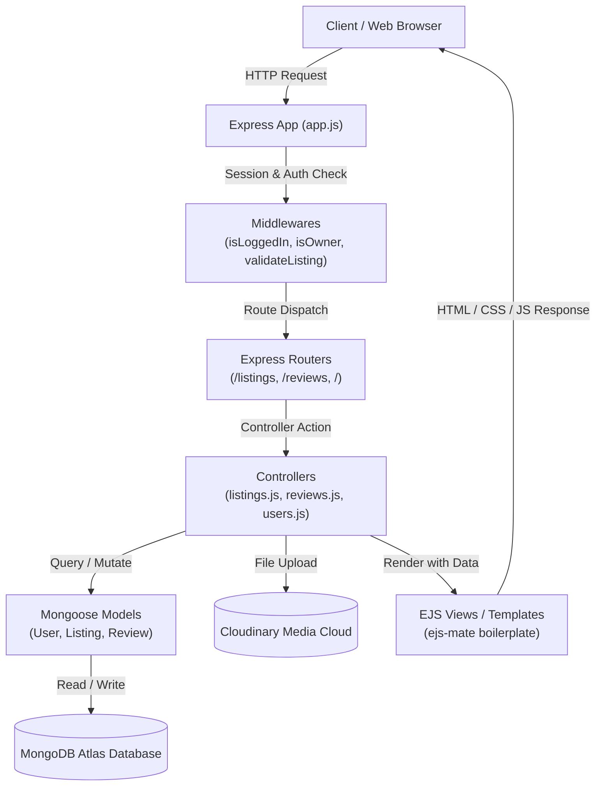
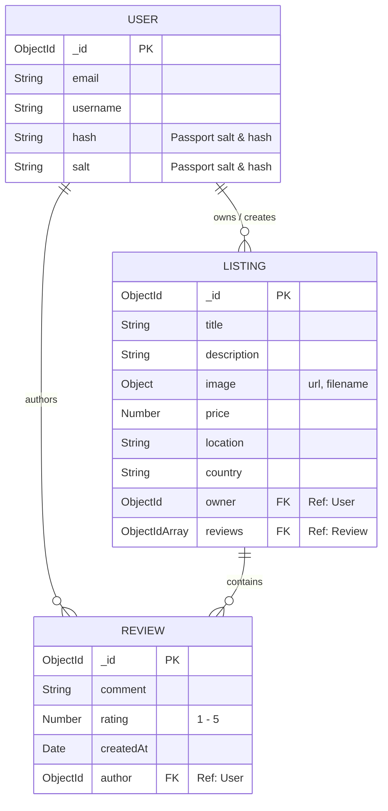

# WanderSpot

[](https://nodejs.org/)
[](https://expressjs.com/)
[](https://www.mongodb.com/)
[](https://cloudinary.com/)
[](https://getbootstrap.com/)
[](https://opensource.org/licenses/ISC)

> **WanderSpot** is a full-stack vacation rental marketplace web application inspired by Airbnb. Built on the **MVC (Model-View-Controller)** pattern with Node.js, Express, MongoDB Atlas, and EJS, WanderSpot enables travelers to explore unique accommodations worldwide and empowers hosts to list, manage, and showcase their properties with seamless cloud-based image storage.

---

## Table of Contents

- [Features](#-features)
- [System Architecture](#-system-architecture)
- [Tech Stack](#-tech-stack)
- [Database Schema & Data Models](#-database-schema--data-models)
- [RESTful API & Route Structure](#-restful-api--route-structure)
- [Project Directory Structure](#-project-directory-structure)
- [Getting Started & Local Setup](#-getting-started--local-setup)
  - [Prerequisites](#prerequisites)
  - [Installation](#installation)
  - [Environment Configuration](#environment-configuration)
  - [Database Seeding](#database-seeding)
  - [Running the Application](#running-the-application)
- [Security & Validation](#-security--validation)
- [Future Enhancements](#-future-enhancements)
- [Author & Acknowledgements](#-author--acknowledgements)

---

## Features

### Property Listings (Full CRUD)
- **Explore Accommodations**: Interactive cards showcasing destination images, property titles, nightly rates (formatted in INR `₹`), locations, and country names.
- **Detailed View**: View high-resolution imagery, detailed descriptions, host information, and customer reviews.
- **Host a Listing**: Registered users can publish new listings complete with image uploads.
- **Edit & Update**: Hosts can update listing details with real-time thumbnail previews of current photos or upload replacements.
- **Cascading Deletion**: Deleting a listing automatically purges all associated reviews from the database to maintain data integrity.

### Dynamic Experience & UI
- **Category Filter Bar**: Intuitive filter categories (*Trending, Rooms, Iconic Cities, Mountains, Amazing Pools, Farms, Arctic*).
- **Interactive Tax Toggle**: Live JavaScript toggle allowing users to switch prices dynamically between base nightly rates and total cost after GST (+18% GST).
- **Responsive Layout**: Designed mobile-first using Bootstrap 5.3 grid breakpoints and modern typography via Google Fonts (*Plus Jakarta Sans*).

### Ratings & Reviews
- **Interactive 5-Star Rating**: Built with CSS starability rating controls (`starability-slot`) allowing intuitive rating submissions (1 to 5 stars).
- **Verified Review Authorship**: Displays the `@username` of the reviewer alongside their review.
- **Review Permissions**: Strict authorization checks guarantee that only the original author can delete their review.

### Authentication & Session Security
- **User Authentication**: Secure user registration, password hashing, and salting via `passport-local-mongoose`.
- **Persistent Sessions**: Sessions backed by `connect-mongo` in MongoDB with auto-refresh (`touchAfter: 24h`) and configurable cookie expiration (7 days).
- **Post-Login Redirection**: Seamless UX that remembers and redirects users back to the page they were originally attempting to access prior to authentication.
- **Ownership Authorization Guards**: Custom middleware ensuring only property owners can modify/delete their listings, and only review authors can delete their reviews.

### Cloud Image Storage
- **Direct Cloud Uploads**: Automated image processing and hosting using **Cloudinary** via `multer-storage-cloudinary`.
- **Image Transformations**: Automated on-the-fly Cloudinary thumbnail URL transformations for quick and lightweight previews on listing edit forms.

### Schema Validation & Robust Error Handling
- **Client-Side Validation**: Real-time Bootstrap validation triggers for all form fields.
- **Server-Side Validation**: Strict request payload validation using **Joi** schemas before reaching controllers.
- **Centralized Error Handling**: Custom `ExpressError` class, async route wrapper (`wrapAsync`), custom 404 page handler, and user-friendly error templates.
- **Flash Messages**: Instant feedback on operations (e.g., successful creation, updates, deletions, or permission denials).

---

## System Architecture

The application implements a decoupled **Model-View-Controller (MVC)** design pattern:



---

## Tech Stack

| Domain | Technology | Description |
| :--- | :--- | :--- |
| **Runtime** | [Node.js (v20+)](https://nodejs.org/) | Asynchronous event-driven JavaScript runtime |
| **Framework** | [Express.js (v4.21)](https://expressjs.com/) | Minimalist web application framework |
| **Database** | [MongoDB Atlas](https://www.mongodb.com/atlas) | Cloud NoSQL document database |
| **ODM** | [Mongoose (v8.8)](https://mongoosejs.com/) | Object Data Modeling library for MongoDB |
| **Session Store**| [connect-mongo (v5.1)](https://www.npmjs.com/package/connect-mongo) | MongoDB-backed session storage for Express |
| **Templating** | [EJS](https://ejs.co/) & [EJS-Mate](https://www.npmjs.com/package/ejs-mate) | Layout boilerplate and server-rendered view templates |
| **Authentication**| [Passport.js](http://www.passportjs.org/) | Authentication middleware with `passport-local` & `passport-local-mongoose` |
| **Media Storage**| [Cloudinary](https://cloudinary.com/) | Cloud storage & image transformation via `multer-storage-cloudinary` |
| **Validation** | [Joi (v17.13)](https://joi.dev/) | Schema description language and data validator |
| **Styling** | [Bootstrap 5.3](https://getbootstrap.com/), Font Awesome 6, Starability CSS | UI component styling, icons, and rating animations |

---

## Database Schema & Data Models



- **Cascading Hooks**: A Mongoose `findOneAndDelete` post-hook ensures that when a listing is removed, any review documents referenced inside its `reviews` array are automatically removed from the database.

---

## RESTful API & Route Structure

### Listings Endpoints (`/listings`)

| HTTP Method | Route | Controller Method | Access | Description |
| :--- | :--- | :--- | :--- | :--- |
| `GET` | `/listings` | `index` | Public | View all destination listings |
| `GET` | `/listings/new` | `renderNewForm` | Authenticated | Display form to create a listing |
| `POST` | `/listings` | `createListing` | Authenticated | Create a new listing (handles image upload & validation) |
| `GET` | `/listings/:id` | `showListing` | Public | View detailed information for a single listing |
| `GET` | `/listings/:id/edit` | `renderEditForm` | Owner Only | Render the listing modification form |
| `PUT` | `/listings/:id` | `updateListing` | Owner Only | Update listing details and optionally upload replacement image |
| `DELETE` | `/listings/:id` | `destroyListing` | Owner Only | Delete listing and cascade delete associated reviews |

### Reviews Endpoints (`/listings/:id/reviews`)

| HTTP Method | Route | Controller Method | Access | Description |
| :--- | :--- | :--- | :--- | :--- |
| `POST` | `/listings/:id/reviews` | `createReview` | Authenticated | Post a review and star rating on a listing |
| `DELETE`| `/listings/:id/reviews/:reviewId` | `destroyReview` | Review Author | Remove a review and update listing references |

### User & Authentication Endpoints (`/`)

| HTTP Method | Route | Controller Method | Access | Description |
| :--- | :--- | :--- | :--- | :--- |
| `GET` | `/signup` | `renderSignupForm` | Public | Render user registration page |
| `POST` | `/signup` | `signup` | Public | Register new user account and log in automatically |
| `GET` | `/login` | `renderLoginForm` | Public | Render login page |
| `POST` | `/login` | `login` | Public | Authenticate credentials and redirect |
| `GET` | `/logout` | `logout` | Authenticated | Destroy user session and log out |

---

## Project Directory Structure

```text
WanderSpot/
├── assets/                     # Static media and brand assets (logo, etc.)
│   └── logo.png
├── controllers/                # Request handlers and business logic
│   ├── listings.js             # Listing CRUD logic & Cloudinary handling
│   ├── reviews.js              # Review creation & deletion logic
│   └── users.js                # Signup, login, and logout routines
├── init/                       # Database initialization and sample data
│   ├── data.js                 # Sample listings seed dataset
│   └── index.js                # Database seeding script
├── models/                     # Mongoose data schemas
│   ├── listing.js              # Listing model with cascade hook
│   ├── review.js               # Review model
│   └── user.js                 # User model with passport-local-mongoose
├── public/                     # Publicly served static assets
│   ├── css/
│   │   ├── rating.css          # Starability star rating styles
│   │   └── style.css           # Custom layout and component styling
│   └── js/
│       └── script.js           # Client-side form validation logic
├── routes/                     # Express route modularization
│   ├── listing.js              # Listing resource routes
│   ├── review.js               # Review nested routes
│   └── user.js                 # Authentication routes
├── utils/                      # Helper utilities and error wrappers
│   ├── ExpressError.js         # Custom operational error class
│   └── wrapAsync.js            # Asynchronous error handler wrapper
├── views/                      # Server-side rendered views
│   ├── includes/               # Reusable view partials
│   │   ├── flash.ejs           # Flash notification alert banners
│   │   ├── footer.ejs          # Common footer partial
│   │   └── navbar.ejs          # Sticky navigation bar with search
│   ├── layouts/
│   │   └── boilerplate.ejs     # Main layout template (ejs-mate)
│   ├── listings/
│   │   ├── edit.ejs            # Edit listing view with preview
│   │   ├── index.ejs           # All listings & category filters view
│   │   ├── new.ejs             # New listing creation form
│   │   └── show.ejs            # Detailed listing view with reviews
│   ├── users/
│   │   ├── login.ejs           # User sign-in form
│   │   └── signup.ejs          # User registration form
│   └── error.ejs               # User-facing error display page
├── .gitignore                  # Git untracked files specification
├── app.js                      # Application entrypoint & middleware configuration
├── cloudConfig.js              # Cloudinary SDK & Multer storage configuration
├── middleware.js               # Authentication, authorization & Joi middlewares
├── package.json                # Project dependencies and engine specifications
└── schema.js                   # Joi schema definitions for server-side validation
```

---

## Getting Started & Local Setup

### Prerequisites

Ensure you have the following installed on your machine:
- [Node.js](https://nodejs.org/) (Version `>= 20.18.0` recommended)
- [npm](https://www.npmjs.com/) (bundled with Node.js)
- A [MongoDB Atlas](https://www.mongodb.com/atlas) cluster (or local MongoDB server)
- A free [Cloudinary](https://cloudinary.com/) account for image hosting

---

### Installation

1. **Clone the repository**:
   ```bash
   git clone https://github.com/sdkrmehta/WanderSpot.git
   cd WanderSpot
   ```

2. **Install dependencies**:
   ```bash
   npm install
   ```

---

### Environment Configuration

Create a `.env` file in the root directory:

```bash
touch .env
```

Add the following environment variables to your `.env` file:

```env
# MongoDB Connection String (MongoDB Atlas or Local Instance)
ATLASDB_URL=mongodb+srv://<username>:<password>@cluster0.mongodb.net/wanderspot?retryWrites=true&w=majority

# Session Secret Key
SECRET=your_super_secret_session_key

# Cloudinary Credentials (from your Cloudinary Dashboard)
CLOUD_NAME=your_cloudinary_cloud_name
CLOUD_API=your_cloudinary_api_key
CLOUD_API_SECRET=your_cloudinary_api_secret
```

> [!NOTE]
> Ensure `.env` is listed in your `.gitignore` to avoid leaking sensitive credentials.

---

### Database Seeding

To populate your database with initial sample destination data:

```bash
node init/index.js
```

*Expected output:*
```text
connected to db
Data was initilize
```

---

### Running the Application

Start the Express web server:

```bash
node app.js
```

Or run with `nodemon` for auto-reloading during development:

```bash
npx nodemon app.js
```

Open your browser and navigate to:
```
http://localhost:8080/listings
```

---

## Security & Validation

- **Credential Hashing**: Uses PBKDF2 hashing algorithm via `passport-local-mongoose` to protect user passwords.
- **Session Protection**: Cookies are configured with `httpOnly: true` to prevent Cross-Site Scripting (XSS) attacks from accessing session IDs.
- **Granular Authorization**: Route-level middleware ensures only authorized users can perform sensitive mutations (`isOwner`, `isReviewAuthor`).
- **Two-Tier Validation**: Client-side feedback via HTML5/Bootstrap validation and strict server-side schema constraints enforced by **Joi**.

---

## Future Enhancements

- [ ] **Interactive Maps**: Integrate Mapbox GL JS / OpenStreetMap for geolocation markers and dynamic maps.
- [ ] **Search & Filtering**: Full-text destination search and multi-criteria filters (price ranges, amenities).
- [ ] **Direct Booking & Calendar**: Date range picker with reservation scheduling and booking management.
- [ ] **Payment Integration**: Stripe / Razorpay checkout integration for online stay payments.
- [ ] **User Profiles**: Host profile pages showcasing all properties hosted by the user.

---

## Author & Acknowledgements

Developed by **[Suraj Deep Kumar Mehta](https://github.com/sdkrmehta)**.

If you find this project helpful or inspiring, feel free to give it a ⭐️ on [GitHub](https://github.com/sdkrmehta/WanderSpot)!
